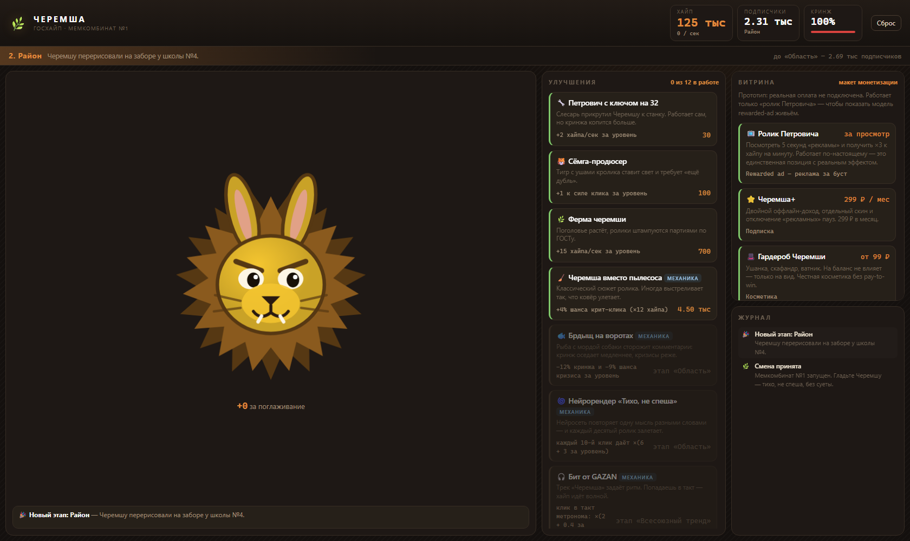
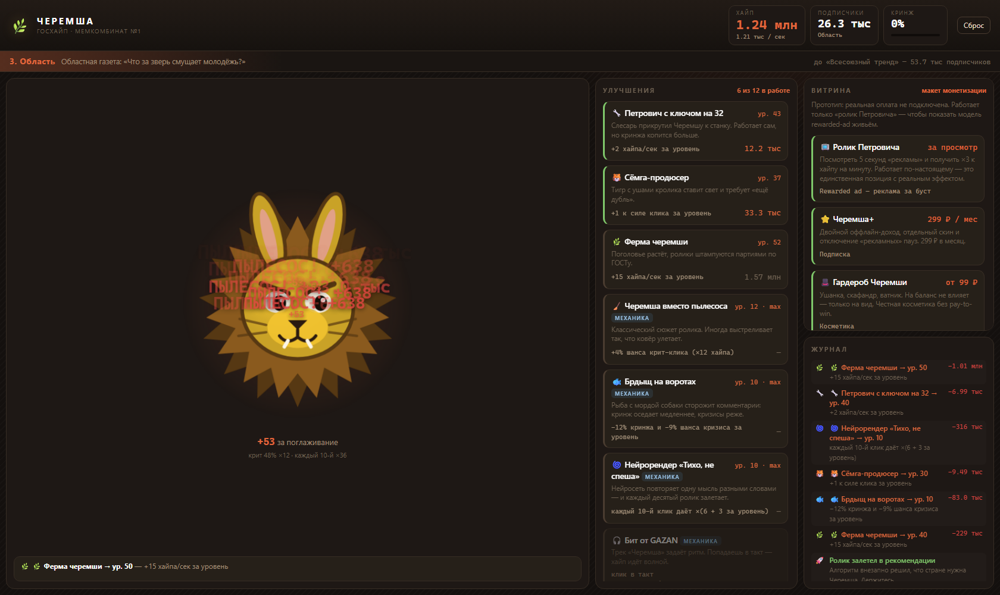
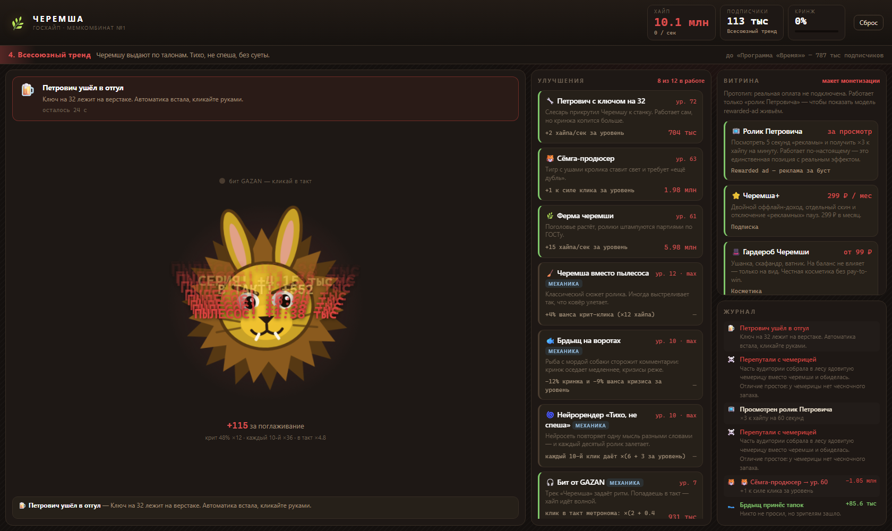
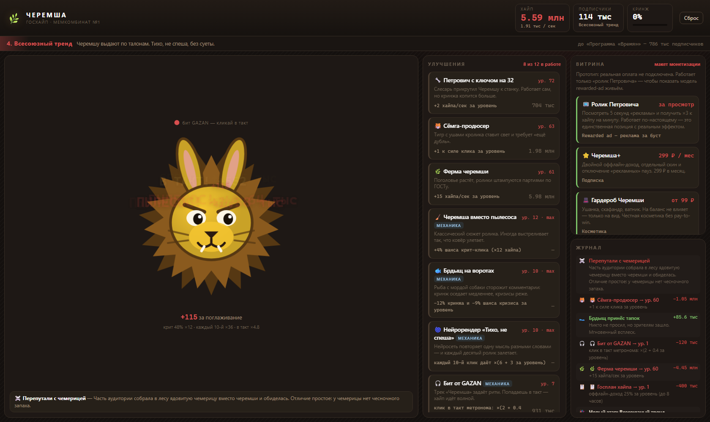
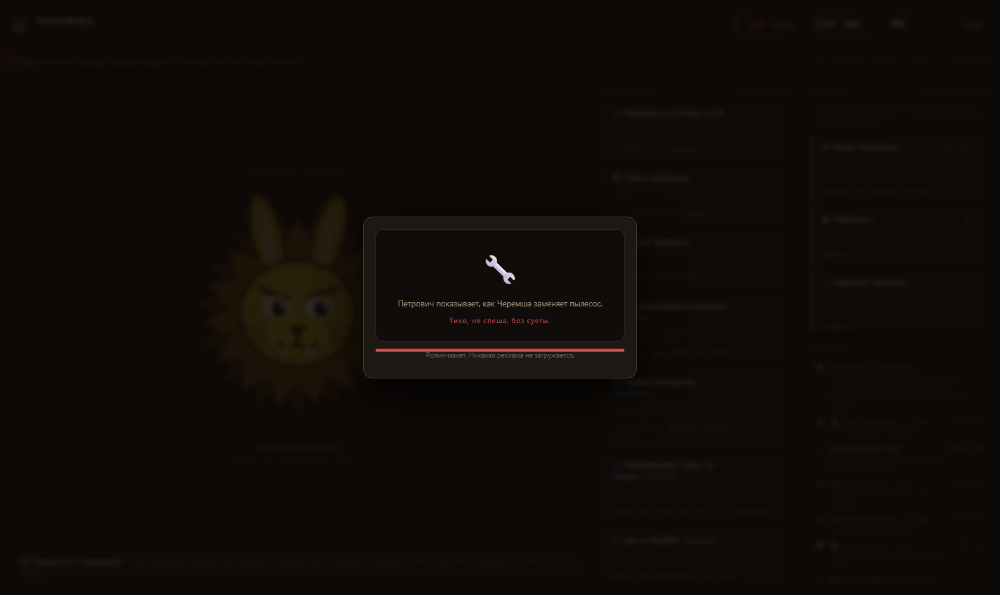
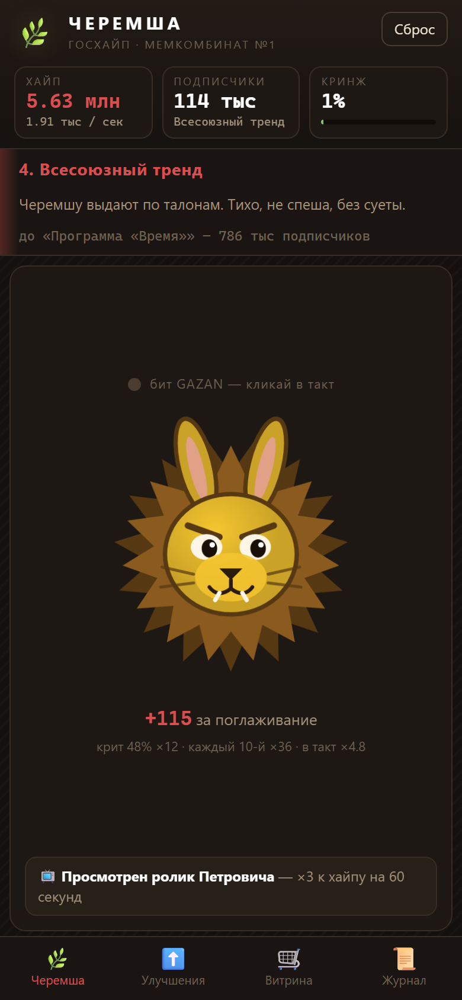
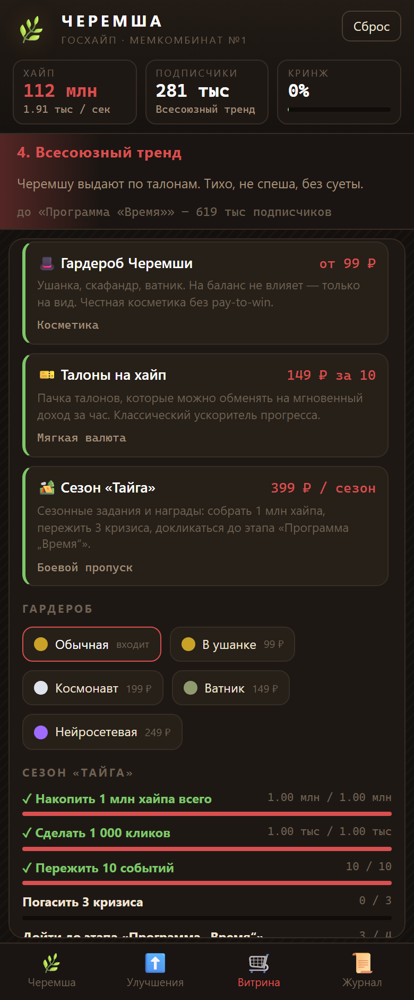
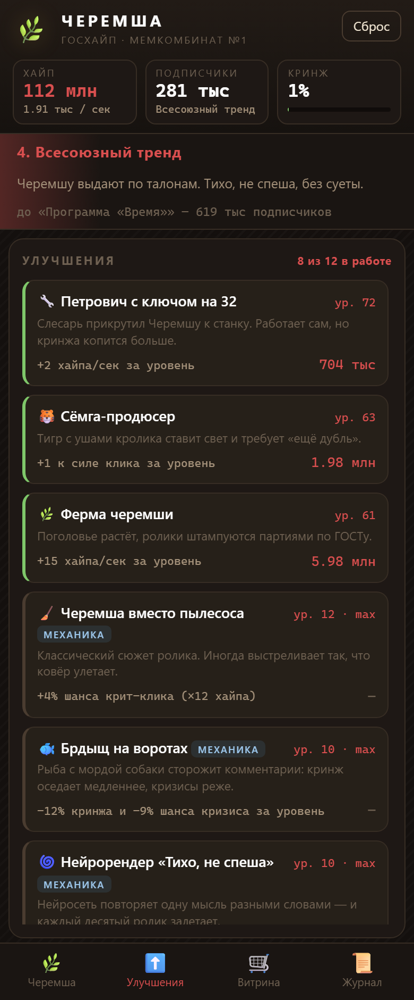

# 🌿 Черемша: Госхайп

Кликер-тайкун по мему **«Черемша»**. Вы — оператор Мемкомбината №1 в
альтернативном СССР: гладите Черемшу, набираете хайп, ставите Петровича к
станку и растите мем от дворового прикола до самоосознавшего себя явления.

Стек: **Python 3.9+ (только стандартная библиотека) + SQLite + vanilla JS**.
Ни `pip install`, ни `npm install` — внешних зависимостей нет. Работает на
desktop и на мобильных.

---

## Про мем

Черемша — вымышленное существо, гибрид льва и зайца. Картинку в 2020 году
опубликовал французский проект Les Créatonautes, а спустя пять лет кто-то
перевёл её в чёрно-белое и подписал «Черемша» — так родился мем. В 2025–2026
годах он слился с волной ИИ-роликов про советский дефицит: «В Советском Союзе
пылесосов не было, вместо него все использовали Черемшу». Оттуда в игру пришли:

- **Петрович** — слесарь, постоянный герой роликов → автоматизация производства;
- **Брдыщ** — рыба с мордой собаки, сторожевое животное → защита от кризисов;
- **Сёмга** — тигр с ушами кролика → продюсер, усиливает клик;
- **«тихо, не спеша, без суеты»** — речевой штамп нейросетей → название
  улучшения «Нейрорендер»;
- трек **GAZAN «Черемша»** (май 2026) → ритм-механика;
- настоящая черемша (медвежий лук), которую путают с ядовитой чемерицей →
  событие-штраф с реальным отличием: у чемерицы нет чесночного запаха.

Источник фактуры: [материал РБК о меме](https://www.rbc.ru/life/news/6a06fac29a79473d20ead761).

Само изображение Черемши не используется: зверь нарисован SVG-ом в
[`web/js/cheremsha.js`](web/js/cheremsha.js), поэтому скины меняются на лету и
нет вопросов к правам на исходник.

---

## Скриншоты

| Начало смены | Разогнанный мемкомбинат |
|---|---|
|  |  |

| Событие: Петрович ушёл в отгул | Витрина монетизации |
|---|---|
|  |  |

| «Ролик Петровича» — rewarded ad |
|---|
|  |

Мобильная версия — та же разметка, одна колонка и нижние вкладки:

| Кликер | Витрина и сезон | Улучшения |
|---|---|---|
|  |  |  |

---

## Запуск

```bash
python server/app.py
```

Браузер откроется сам на `http://127.0.0.1:8000/`. На Windows, если Python не в
`PATH`, работает `py -3 server/app.py` или просто `run.bat`; на macOS/Linux —
`./run.sh`.

```bash
python server/app.py --port 8770 --no-browser
```

Сейв создаётся автоматически в `data/cheremsha.db`. Кнопка «Сброс» в шапке
начинает партию заново.

**Мобильный режим.** Откройте тот же адрес с телефона в одной сети
(`python server/app.py --host 0.0.0.0`) — раскладка переключается на одну
колонку с нижними вкладками «Черемша / Улучшения / Витрина / Журнал».

### Развернуть онлайн

Правила и сейв живут на сервере, поэтому нужен хостинг с Python — GitHub Pages
отдаёт только статику и не подойдёт. На Render, Railway, PythonAnywhere или
своём VPS хватает одной команды запуска:

```bash
python server/app.py --host 0.0.0.0
```

Порт и хост читаются из переменных окружения `PORT` и `HOST`. На бесплатных
тарифах диск обычно эфемерный: `data/cheremsha.db` пересоздастся после
перезапуска сервиса, и прогресс демо обнулится.

---

## Core loop

```
гладишь Черемшу → хайп → улучшения → больше хайпа в секунду
       ↑                                        ↓
   кринж падает                          кринж растёт
       ↑                                        ↓
   ручной клик  ←—— выгодно кликать живьём ——  штраф к доходу
                                                ↓
                            подписчики → новый этап → новые улучшения и события
```

1. **Действие игрока** — клик по Черемше. Даёт хайп, сбивает кринж и немного
   добавляет подписчиков.
2. **Хайп** — основная валюта, тратится на улучшения.
3. **Подписчики** — прогресс: они капают от производства хайпа и открывают
   8 этапов, от «Двора» до «Черемша осознала себя».
4. **Кринж** — противовес идлу (подробнее ниже).
5. **События** — каждые 38–85 секунд что-то происходит: бонус, кризис, штраф или
   мемный поворот.

### Кринж — механика против «оставил вкладку и ушёл»

Автоматика копит кринж (**+0.9 в секунду**, если есть пассивный доход), а живой
клик его сбивает (**−0.42 за клик**). Пока кринж ниже 45 — штрафа нет; дальше
доход падает линейно вплоть до **−60 %** на сотне:

```
штраф = 1 − max(0, (кринж − 45) / 55) × 0.6
```

Чтобы удержать кринж на нуле, нужно примерно **2.2 клика в секунду** — или
вложиться в «Брдыща на воротах», который срезает накопление до −12 % за уровень.
Побочный эффект: кринж душит и приток подписчиков, то есть тормозит прогресс по
этапам, а не только доход.

---

## Экономика

### Формулы

```
сила клика   = (1 + Σ прибавок клика) × общий множитель × множитель этапа × штраф кринжа
доход в сек  = (Σ пассивных прибавок)  × общий множитель × множитель этапа × штраф кринжа
подписчики  += прирост хайпа × 0.0034 × (1 − кринж/100 × 0.9)
цена уровня  = базовая × (1 + (рост − 1) × (1 − скидка «Архива»))^текущий уровень
```

Весь баланс лежит в одном файле — [`server/config.py`](server/config.py), список
улучшений и событий в [`server/content.py`](server/content.py).

### Этапы

| # | Этап | Подписчиков | Множитель |
|---|---|---|---|
| 1 | Двор | 0 | ×1.0 |
| 2 | Район | 400 | ×1.15 |
| 3 | Область | 5 000 | ×1.4 |
| 4 | Всесоюзный тренд | 80 000 | ×1.8 |
| 5 | Программа «Время» | 900 000 | ×2.4 |
| 6 | Экспорт: дубляж на 12 языков | 15 млн | ×3.2 |
| 7 | Черемша на орбите | 300 млн | ×4.5 |
| 8 | Черемша осознала себя | 8 млрд | ×6.5 |

Этап — это не только множитель: он меняет акцентный цвет интерфейса и открывает
новые улучшения и события. «Бит от GAZAN» появится только на «Всесоюзном
тренде», «Сигнал с орбиты» — только в космосе.

### Улучшения: 12 штук, 6 из них меняют механику

| Улучшение | Что делает | Тип |
|---|---|---|
| 🔧 Петрович с ключом на 32 | +2 хайпа/сек за уровень | доход |
| 🐯 Сёмга-продюсер | +1 к силе клика | клик |
| 🌿 Ферма черемши | +15 хайпа/сек | доход |
| 🧹 Черемша вместо пылесоса | **крит-клики**: +4 % шанса на ×12 | механика |
| 🐟 Брдыщ на воротах | **режет накопление кринжа и вероятность кризисов** | механика |
| 🌀 Нейрорендер «Тихо, не спеша» | **каждый 10-й клик даёт ×(6 + 3 за уровень)** | механика |
| 🎧 Бит от GAZAN | **ритм-режим: клик в такт метронома ×(2 + 0.4)** | механика |
| 📋 Госплан хайпа | **оффлайн-доход, до 8 часов** | механика |
| 🗄️ Мемный архив | **−3.5 % к росту цен всех улучшений** | механика |
| 🌍 Отдел дубляжа | +22 % ко всему хайпу | множитель |
| 🛰️ Орбитальный ретранслятор | +900 тыс хайпа/сек | доход |
| 👁️ Самосознание мема | +100 % ко всему хайпу | множитель |

ТЗ требует минимум два улучшения, меняющих механику, — здесь их шесть, и каждое
меняет то, *как* играешь: крит-клики добавляют случайность, комбо просит считать
до десяти, ритм-режим — попадать в такт, «Госплан» вообще включает оффлайн-доход,
«Архив» перестраивает кривую цен, а Брдыщ работает с системой событий.

### Темп (по симуляции, 4 клика в секунду)

| Этап | Достигнут на |
|---|---|
| Район | 2.9 мин |
| Область | 10.5 мин |
| Всесоюзный тренд | 47.7 мин |

За час активной игры набегает ~116 млн хайпа и ~180 тыс подписчиков. Скрипт
симуляции лежал в черновиках и использовался только для подбора баланса.

---

## События

Двенадцать событий: **3 бонуса, 3 кризиса, 2 штрафа, 4 мемных поворота** — и
это больше требуемого минимума в три штуки.

- Кубик бросает **сервер**, а не клиент: веса, доступность по этапу и условие по
  кринжу живут в [`server/engine.py`](server/engine.py) (`roll_event`).
- При кринже выше 70 вероятность кризисов растёт в 1.9 раза, а «Брдыщ»
  пропорционально её снижает — события связаны с механикой, а не просто падают
  по таймеру.
- Часть событий выключает механику целиком: «Петрович ушёл в отгул» обнуляет
  пассивный доход на 25 секунд, и играть приходится руками.
- Три кризиса можно **погасить досрочно** за процент от текущего хайпа —
  например «Оформить по форме №7» за 18 % баланса.
- Событие «Перепутали с чемерицей» несёт реальный факт: чемерица ядовита, а
  отличается отсутствием чесночного запаха.

---

## Где данные

Всё в SQLite — `data/cheremsha.db`, схема в [`server/db.py`](server/db.py).
Прогресс переживает перезагрузку страницы и перезапуск сервера.

| Таблица | Что хранит |
|---|---|
| `player` | хайп, всего хайпа, подписчики, кринж, клики, этап, скин, подписка, счётчики, время последнего визита |
| `upgrades` | уровень каждого улучшения и сколько на него потрачено |
| `purchases` | каждая покупка уровня отдельной строкой: что, какой уровень, почём, когда |
| `events` | журнал: события, вехи покупок, оффлайн-доход, обращения к витрине |
| `shop_log` | обращения к витрине монетизации с указанием модели |

Покупки специально разведены с журналом: в `purchases` пишется каждая, а в ленту
событий попадают только вехи (первый уровень и каждый десятый) — иначе журнал
превращается в стену из сотен строк «куплено».

Посмотреть данные можно чем угодно:

```bash
python -c "import sqlite3;c=sqlite3.connect('data/cheremsha.db');print(*c.execute('select upgrade,count(*),round(sum(cost)) from purchases group by upgrade'))"
```

### Как устроено сохранение

- Клиент шлёт своё состояние на `/api/sync` **раз в 4 секунды** и ещё раз через
  `sendBeacon` при уходе со страницы.
- Каждая покупка идёт отдельным запросом и сохраняется сразу.
- При загрузке страницы сервер смотрит `last_seen` и, если куплен «Госплан
  хайпа», начисляет оффлайн-доход (до 8 часов) и показывает экран «Госплан
  выполнен».

### Разделение клиент / сервер

Осознанное: **цикл считает браузер, правила и данные — сервер.**

Кликер не может ходить на сервер за каждым тапом, поэтому клики, доход в
секунду, кринж и таймеры крутятся в `requestAnimationFrame`. Но всё, что задаёт
правила, живёт на сервере: цены улучшений и все производные множители считает
`Engine.derive()`, событие выбирает `Engine.roll_event()`, оффлайн-доход
начисляет `Engine._grant_offline()`, покупку валидирует `Engine.buy()` (проверяет
этап, потолок уровня и хватает ли хайпа). Античит в прототипе не цель — но
экономику нельзя «переиграть» из консоли, потому что цены и эффекты клиент не
придумывает, а получает.

---

## Монетизация: пять моделей, без реальной оплаты

Витрина в интерфейсе — рабочий макет: каждое обращение пишется в `shop_log` с
пометкой модели, но платёж не подключён.

| Модель | Позиция | Что даёт |
|---|---|---|
| **Rewarded ad** | 📺 Ролик Петровича | **Работает по-настоящему:** 5 секунд «ролика» → ×3 к хайпу на минуту, кулдаун 3 минуты. Сделано живьём, чтобы механику можно было потрогать, а не только прочитать. |
| **Подписка** | ⭐ Черемша+, 299 ₽/мес | Двойной оффлайн-доход, отдельный скин, без «рекламных» пауз. |
| **Косметика** | 🎩 Гардероб, от 99 ₽ | Пять скинов: ушанка, скафандр, ватник, нейросетевая. На баланс не влияют — честная косметика без pay-to-win. В прототипе выдаются бесплатно. |
| **Мягкая валюта** | 🎫 Талоны на хайп, 149 ₽ | Ускоритель: обмен на мгновенный доход за час. |
| **Боевой пропуск** | 🏕️ Сезон «Тайга», 399 ₽ | Пять сезонных заданий с прогрессом — они реально считаются по данным из `player`. |

Почему такой набор: реклама монетизирует тех, кто не платит, косметика — тех,
кто платит за самовыражение, пропуск удерживает и даёт повод возвращаться,
подписка сглаживает выручку, а мягкая валюта ловит импульсные покупки. Кринж и
оффлайн-доход тут не случайны: именно они создают естественные точки, где игроку
хочется буст, — и это места, куда монетизация встраивается без ломки баланса.

---

## Структура проекта

```
server/
  app.py       HTTP-сервер (http.server), роутинг, отдача статики
  engine.py    правила: производные множители, покупки, события, оффлайн-доход
  content.py   контент: этапы, 12 улучшений, 12 событий, витрина, скины
  config.py    весь числовой баланс
  db.py        схема SQLite
web/
  index.html   разметка (одна и та же для desktop и mobile)
  style.css    тема + мобильная раскладка с вкладками
  js/api.js       обёртка над HTTP API
  js/cheremsha.js рисование зверя в SVG (скины, анимации)
  js/ui.js        рендер панелей, журнала, модалок
  js/main.js      игровой цикл, буффы, события, синхронизация
data/          cheremsha.db (создаётся автоматически)
docs/          скриншоты
```

### API

| Метод | Эндпоинт | Назначение |
|---|---|---|
| `GET` | `/api/state` | полный снимок: игрок, улучшения с ценами, этапы, витрина, журнал, конфиг; здесь же начисляется оффлайн-доход |
| `GET` | `/api/stats` | сводка по покупкам и событиям из базы |
| `POST` | `/api/sync` | автосейв прогресса |
| `POST` | `/api/buy` | купить уровень улучшения (сервер валидирует) |
| `POST` | `/api/roll-event` | сервер бросает кубик и возвращает событие |
| `POST` | `/api/fix-event` | погасить кризис за хайп |
| `POST` | `/api/shop`, `/api/skin` | витрина и скины |
| `POST` | `/api/reset` | новая партия |

Ошибки приходят как `400 {"error": "человеческий текст"}` и показываются тостом.

---

## Мобильная версия

Одна и та же разметка. На ширине до 900 px раскладка переключается на одну
колонку с нижней панелью вкладок, шапка перестраивается в две строки, а Черемша
масштабируется под ширину экрана. Учтены `safe-area-inset` для айфонов с чёлкой,
отключён двойной тап-зум и подсветка тапа, клик ловится через `pointerdown` —
поэтому на телефоне нет 300-мс задержки. Проверялось на 390×844.

---

## Что использовалось из AI

Проект написан в паре с **Claude (Anthropic)** через Claude Code:

- **Сбор фактуры по мему.** Материал РБК разобран моделью: откуда взялась
  картинка, почему мем слился с трендом ИИ-роликов про советский дефицит, кто
  такие Петрович, Брдыщ и Сёмга, при чём тут трек GAZAN и ядовитая чемерица. Из
  этого собран сеттинг: каждое улучшение и событие опирается на конкретную
  деталь мема, а не придумано с нуля.
- **Проектирование и код.** Движок, схема базы, HTTP-слой, фронтенд и SVG-зверь
  написаны в диалоге с моделью. Архитектурные развилки решались вручную:
  например, где проходит граница клиент/сервер и почему покупки валидирует
  сервер, а тик считает браузер.
- **Балансировка через симуляцию.** Отдельным скриптом прогонялся час игры на
  4 кликах в секунду. Первая версия открывала второй этап только к 7-й минуте, а
  третий — к 26-й; после правки `SUBS_PER_HYPE` и порогов этапов получилось
  2.9 / 10.5 / 47.7 минуты — так за первые десять минут видно смену двух этапов.
  Кринж тоже подбирался по симуляции: 0.9 в секунду против 0.42 за клик — это
  ровно те 2.2 клика в секунду, которые держат счётчик на нуле.
- **Тексты.** Названия улучшений, описания событий, реплики в духе роликов.
- **Проверка результата.** Прогон API, симуляция партии и снятие скриншотов
  (включая мобильные) скриптом через Chrome DevTools Protocol. Именно так
  нашлись две ошибки вёрстки: схлопнувшийся список витрины и не прятавшийся
  индикатор ритма.

Внешние ассеты не использовались: зверь, интерфейс и анимации — SVG, CSS и
canvas-free вёрстка.

---

## Что бы доделал дальше

- Престиж: «пересобрать мем с нуля» за постоянный множитель.
- Реальные ачивки и таблица рекордов по seed.
- Звук: бит GAZAN как метроном вместо визуального индикатора.
- Тесты на движок (сейчас проверка ручная, через скрипт-симулятор).
- Серверная валидация темпа кликов — сейчас клиенту доверяют.
